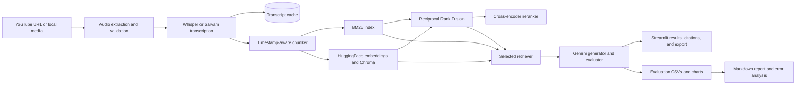

# Architecture and data flow

## Components

## Numbered data flow

1. The user supplies a YouTube URL or a local audio/video file.
2. Ingestion validates the source and extracts/resamples audio.
3. Whisper transcribes English locally; Hindi/Hinglish uses Sarvam. Automatic language handling starts with Whisper detection and routes Hindi audio to Sarvam.
4. Transcription segments retain audio-relative start and end times and are cached by source and language.
5. The chunker creates configurable, overlapping, timestamp-aware transcript windows.
6. The app builds sparse BM25 and/or dense HuggingFace embedding indexes in a per-video Chroma cache.
7. Baseline, sparse, dense, or hybrid retrieval selects context; hybrid merges rankings with RRF and reranks with a cross-encoder.
8. Gemini generates the title, summary, key points, and grounded answers; retrieval citations link back to source timestamps.
9. Streamlit presents results and the evaluation runner records metrics, charts, and error-analysis material.

## Retrieval approaches compared

| Approach | Context selection | Main trade-off |
|---|---|---|
| Baseline | Full transcript, truncated to configured context size | Simple reference baseline; expensive and may omit later content |
| Sparse | BM25 lexical ranking | Fast and explainable; weak on paraphrase |
| Dense | HuggingFace embeddings with Chroma | Handles semantic similarity; requires embedding/index setup |
| Hybrid | BM25 + dense RRF + cross-encoder reranking | Higher retrieval quality potential at greater latency and compute cost |

## Measurement

Evaluation measures timestamp-based Recall@3 and Recall@5, MRR, hit rate, answer faithfulness and relevance, ROUGE-L, BERTScore, summary quality/compression, end-to-end query latency, transcription time, estimated token counts, and cost when explicit LLM token rates are configured. No report values are filled in until a real evaluation run completes.
